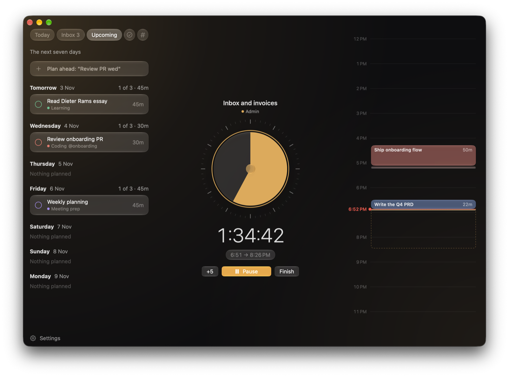
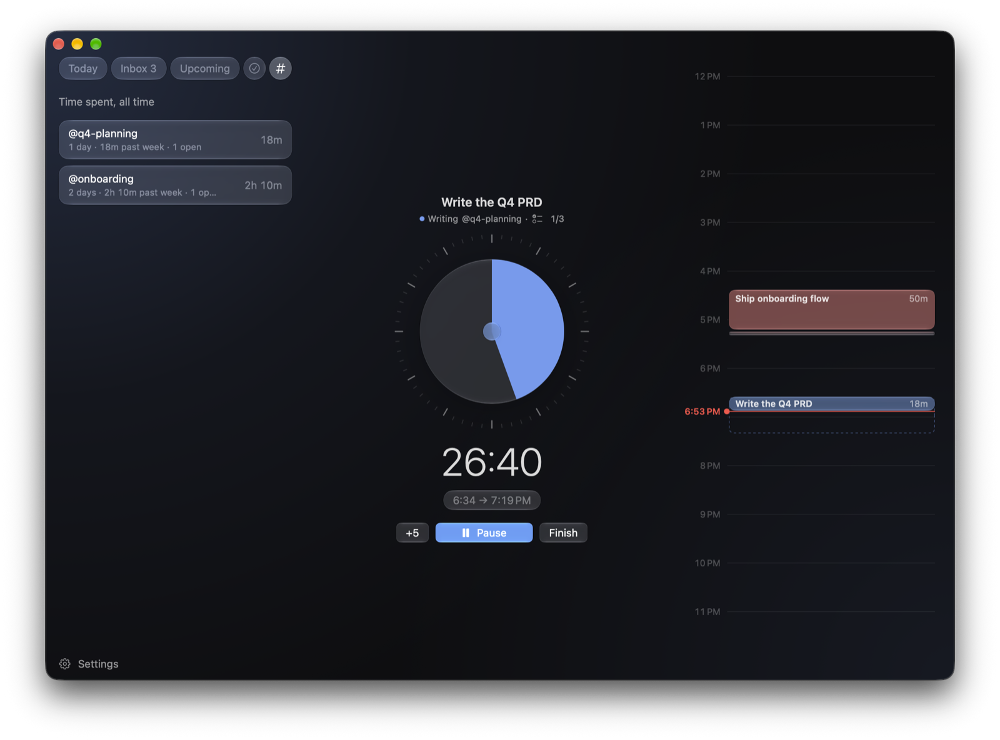

# Three

A focus planner for the ADHD brain, built for macOS 26 with Liquid Glass.

You plan three things for today, give each one a time block, and work through them one at a time on a dial timer. Five a day is the most it allows. Anything else waits in the inbox until you give it a day. Every focus block ends with a short check-in and a break.



## Why

The hard part of ADHD is usually not the work itself. It is picking what to do, starting it, staying with it, and stopping when the time is up. Most tools either do too much (another system to manage) or too little (a bare timer that doesn't know what today is for). Three answers one question at a glance: **what am I doing right now, for how long, and is it part of today's plan?**

The full product spec, with principles, data model and roadmap, is in [PRODUCT.md](PRODUCT.md).

## What it does

- **Three movable panes.** Tasks (Today, Upcoming, Inbox, Done or Tags), the focus dial, and the day's timeline fill the window as rounded translucent panes with plain headers. Drag a header onto another pane to reorder, or use its menu or View → Arrange Panes. Order is remembered; Reset Pane Order restores Tasks, Now, Timeline. Drag the gaps between panes to adjust widths.
- **Three by default, five at most.** A fourth or fifth task brings a gentle warning, and a sixth is refused.
- **Focus blocks.** Each task has a block, for example 90 minutes, that you work through in sessions (45 minutes by default, up to 4 hours, set in Settings → Timer). Drag the dial to change one; past 12 o'clock it winds on into another hour. You can pause, add five minutes or finish early.
- **Reflection, then a break.** When a block ends, a small panel asks how it went, then starts a short or long break based on how long you've been focusing. After two minutes without an answer or edit, it ends the block with Made progress and Okay and keeps your note. A menu-bar dot lets you review or dismiss that reflection later.
- **Inbox and Upcoming.** Capture anything without a day, and see the next seven days. A hover sends a task to today or tomorrow.
- **Quick add**, Todoist style: `Fix signup bug #coding @onboarding 30m fri`. Press ⌘N anywhere, or use the field in the menu bar.
- **Tags** for work that runs for days or weeks, such as a product, project or feature. Tags shows how much time each one has taken in total and in the past week, and each task's share. A task carried to tomorrow keeps its tags.
- **Done.** What you finished in the last 30 days, with the time each task took.
- **Task cards.** Click a title to rename it in place. The ⋯ menu holds the rest: schedule, block length (including Custom…), category, tags, move, drop and delete. Category and tags sit at the bottom of the card.
- **Unfinished from earlier days.** Open tasks from a past day wait in their own section on Today, never silently in the Inbox. Accept one onto today or a later day, or dismiss it; steps, tags and history come along.
- **Review sheet.** Day Review, History and Trends open in one sheet over the workspace (⌘6 to ⌘8, Escape closes). Day Review steps through every closed day.
- **Notch controls.** On a Mac with a notch, the time and the task's ring sit either side of the camera. Rest the pointer there for a moment, or click, to open Pause, Finish and Open Three below it. Turn it off in Settings → Timer.
- **Steps.** Break a task into small checkboxes. The running task shows its steps and notes in place, and Now shows the next step with a one-click check.
- **Priority order.** Drag a Today card by its title row to reorder, or use Move Up and Move Down. The top open task is the one the dial offers next.
- **Categories** with colours, which carry through the timer, cards and timeline. Edit them in Settings.
- **Menu bar.** The timer, the next task and a capture field are always one click away.
- **Blocking during focus** (built, not yet in a release). Pick websites and apps in Settings → Blocking. During a focus session, and during weekly focus hours if you set them, Chrome shows a calm block page instead of a blocked site and blocked apps are hidden, never quit. To open one for five minutes you write a reason and wait 20 seconds, in Three only; a strict task turns that off. Chrome blocking works with Three closed; hiding apps needs Three running. Safari, other browsers and Chrome's Guest and Incognito windows aren't covered. Details in [PRODUCT.md §7](PRODUCT.md#7-distraction-blocker).
- **A CLI for you and your AI.** `three` reads and writes the same database as the app, so Claude Code, Codex or a script can plan your day. Changes show up in the app straight away.



## Keyboard controls

The Edit, Focus and Go menus show these commands and disable actions that do not apply.

| Action | Shortcut |
| --- | --- |
| Quick add | ⌘N |
| Today, Upcoming, Inbox, Done, Tags | ⌘1 through ⌘5 |
| Day Review, History, Trends | ⌘6, ⌘7, ⌘8 |
| Start focus | ⌘Return |
| Pause or resume | ⇧⌘P |
| Add five minutes | ⌘+ |
| Finish and reflect | ⇧⌘Return |
| Review a saved reflection | ⇧⌘R |
| Adjust the focused idle dial | Arrow keys, five minutes at a time |
| Move the selected Today task up or down | ⌥⌘↑ / ⌥⌘↓ |
| Start the suggested break in a reflection | Return |
| Close a reflection | Escape |

Task titles, tag headers, and checklist rows use native buttons. Tab navigation follows your macOS keyboard-navigation setting. Quick Add uses Inbox when today's five slots are full.

## Install

You need macOS 26 or later and the Xcode Command Line Tools (`xcode-select --install`). Full Xcode isn't required.

```bash
git clone https://github.com/ddeyalla/three.git
cd three
make install
```

This builds a release copy to `~/Applications/Three.app`, links the CLI at `~/.local/bin/three` and opens the app. Make sure `~/.local/bin` is on your `PATH`.

Your data lives in `~/Library/Application Support/Three/three.sqlite`.

## Use it from the terminal or an AI agent

```bash
three today [--date tomorrow] [--json]
three plan "Ship onboarding:Coding:90" "Write PRD:Writing:60" "Inbox:Admin:30m" [--commit]
three capture "Fix signup @onboarding #coding 30m" # no day goes to the inbox; or today/tomorrow/fri
three inbox | three upcoming
three schedule i1 tomorrow                        # i1 is the first inbox item; "inbox" unplans it
three step add 2 "Outline the problem" | three step done 2 1
three start [task#] [--min 25]
three pause | resume | extend [5] | stop
three done 2 [--note "merged"]                   # or a task id from any open day
three tags [--json] | three tags add 2 onboarding  # time per tag; tag a task
three logbook [--days 30]                         # what you finished
three history --from 2026-10-01 --to 2026-11-03 --json # month, day, task, and session detail
three stats [--from 2026-10-07 --to 2026-11-03] --json # five trends, per-tag values, and bounded streak
three recovery --json # read interruptions and pending Keep/Trim reviews
three recovery-decide GAP_UUID --decision trim --json # explicitly keep or trim; first saved decision wins
three drop 3 | tomorrow 3
three status [--json]
three categories [add Health --color "#4FBF8B" | rename A B | color A "#hex" | archive A]
three settings [--session 50 --short-break 5 --long-break 15 --block 60]
three block [status] [--json]                     # whether blocking is on, why, until when, and what isn't covered
three block add reddit news.ycombinator.com com.apple.Music  # prints "Blocked site/app …"
three block add --app /Applications/Slack.app --site app.zoom.us  # force the kind when the guess is wrong
three block hours add mon-fri 10:00-13:00         # weekly focus hours; 22:00-02:00 runs past midnight
three block connect-chrome                        # the same Chrome setup as Settings → Blocking
```

Installed apps, absolute `.app` paths and bundle IDs like `com.apple.Music` become app rules; anything else is a website. Use `--app` for unusual bundle IDs such as `us.zoom.xos`. `three block` only adds. Remove rules and change focus hours in the app, while blocking is off.

To let Claude Code or Codex drive Three through MCP:

```bash
claude mcp add -s user three -- ~/.local/bin/three mcp   # Claude Code, every project
```

```toml
# ~/.codex/config.toml
[mcp_servers.three]
command = "/Users/you/.local/bin/three"
args = ["mcp"]
```

Start a new session and ask in plain words: "plan tomorrow", "start a focus block on X", "how did this week go". Agents edit your real data; add `THREE_DB` to the server's environment to point them at a scratch copy.

To give an agent plain CLI instructions instead, open **Settings → Connect** and copy the instructions into your `CLAUDE.md` or `AGENTS.md`. The built, unreleased v0.4 adds `three mcp`, native draft review, and opt-in scheduled planning. See the [MCP tools](docs/MCP.md), [draft review](docs/planning.md), and [scheduled planning](docs/scheduled-planning.md) guides.

## Develop

```bash
make build     # debug build of build/Three.app
make run       # build, then launch
make test      # design lint, core and app tests (Swift Testing), extension tests (node --test)
make install   # release build to ~/Applications, CLI linked at ~/.local/bin/three
```

Design rules live in [DESIGN.md](DESIGN.md): one family (SF Pro), six type roles, one spacing scale, Liquid Glass surfaces. The roles are defined once in `Sources/ThreeApp/Theme.swift`, and `scripts/lint-design.sh` (run by `make test`) rejects any view that sets a font directly.

The app is a SwiftPM package with no Xcode project:

| Target | What it is |
|---|---|
| `ThreeCore` | Models, the GRDB/SQLite store, migrations, planning rules, quick-add parsing |
| `ThreeApp` | The SwiftUI app: window, menu bar, settings, reflection panel |
| `ThreeCLI` | The `three` command, bundled inside the app at `Contents/Helpers/three` |

`scripts/bundle.sh` assembles the `.app` from the SwiftPM products and ad-hoc signs it. Launch through the bundle with `open`, not `swift run`, because notifications need a bundle identifier.

`scripts/swift.sh` wraps `swift` for building with the Command Line Tools alone:

- It builds against the macOS 26.5 SDK. In the 27 SDK, SwiftUI's `@State` is a macro whose plugin ships only with Xcode. The 26.5 SDK still has Liquid Glass.
- Some Command Line Tools installs carry stale `*.private.swiftinterface` files that shadow the current `PackageDescription`. The wrapper points SwiftPM at a cleaned copy.

### Running a demo copy

```bash
scripts/demo.sh                                   # seeds a realistic day in $TMPDIR/three-demo.sqlite
open -n --env THREE_DB=$TMPDIR/three-demo.sqlite --env THREE_OPEN=tags build/Three.app
scripts/shot.sh <pid> build/today.png             # screenshot that window (needs Screen Recording)
```

`THREE_DB` points the app and CLI at another database. `THREE_OPEN` takes `today`, `inbox`, `upcoming`, `done`, `tags`, `settings` or `blocking`, or `day`, `history` or `trends` to open the Review sheet. `THREE_CHROME_DATA` points the app's Chrome setup at another Chrome data folder (the CLI takes `--chrome-folder`), so a test copy never writes into your real Chrome profile. Keep demo databases outside `~/Documents`, or macOS asks the freshly signed build for folder access and the app waits on the prompt.

## Roadmap

| Version | Milestone | Status |
|---|---|---|
| v0.1 | Core loop: plan, dial timer, reflection, breaks, timeline, CLI | Done |
| v0.2 | Plan and capture: inbox, upcoming, quick add, steps, categories, settings, tags, three panes | Done |
| v0.3 | Site and app blocker during focus: Chrome and apps | Built, unreleased |
| v0.4 | MCP server and AI planning | Built, unreleased |
| v0.5 | Calendar sync | |
| v0.6 | Session record, day close, history and trends | Built, unreleased |
| v1.0 | Polish | |

## Versioning

- One semantic version per milestone. Fixes within a milestone bump the patch, for example 0.2.2. `VERSION` holds the marketing version.
- The build number is `git rev-list --count HEAD`, stamped by `bundle.sh`.
- Each release is tagged `vX.Y.Z` and described in [CHANGELOG.md](CHANGELOG.md).

To cut a release: update `VERSION` and `CHANGELOG.md`, commit, `git tag -a vX.Y.Z`, then `make install`.
